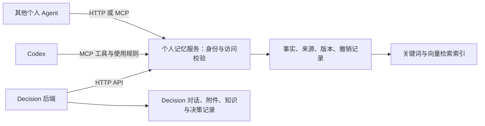

# Decision 产品检查与改造方案

日期：2026-11-13（北京时间）。状态：调查和设计建议，尚未实施；供本轮讨论后确定开发范围。

## 1. 目标与检查边界

采用 Codex 成熟的通用 Agent 产品组织方式，让 Decision 专注个人决策。用户不需要逐个提出侧边栏、设置、附件、停止、恢复等基础需求。沿用现有桌面应用与业务资产，不预设替换为 Codex app-server。

用户已明确：共享记忆的参与方是 **Decision、Codex 和自己的其他个人 Agent**。工作项目不纳入；不连接公司记忆库，不迁移真实个人历史。本轮只产出检查和改造方案。

本次独立只读审查已完成。代码检查基线为桌面工作区 `codex/decision-desktop`，提交 `d64c50c5ea96d014aaeb88d9510ab5bdcc866706`；主目录 `integration/mvp-20261104` 是更旧的网页集成基线，不能据此宣称桌面能力不存在。本文件放在总控拥有的 `docs/`，未修改业务代码。

检查依据：最新桌面源码、原项目契约、桌面验收记录，以及本次打开核对的官方文档。应用界面读取工具超时，因此本轮是**源码与设计层的系统检查**，不是重新完成所有界面的点击验收。以下“已有”表示找到实现，历史实测另列；“缺少”限定于本次基线的产品入口/链路。没有运行本轮模型调用、测试套件或数据迁移。

官方参照：

- [设置](https://learn.chatgpt.com/docs/reference/settings)：通用设置集中组织，涵盖输入、外观、快捷键、通知、个性化与记忆控制。
- [项目与聊天](https://learn.chatgpt.com/docs/projects?surface=app)：固定、搜索、重命名和归档等组织方式。
- [桌面命令](https://learn.chatgpt.com/docs/app/commands)：常用动作具有可发现的键盘入口。
- [记忆](https://learn.chatgpt.com/docs/customization/memories)：宿主本身有独立的记忆使用/生成控制。
- [App Server](https://learn.chatgpt.com/docs/app-server)：会话、事件、执行中补充、停止与审批的参考语义；不是本方案已选运行时。

下面的功能表是根据 Decision 场景提出的产品要求，不表示每项都是 Codex 当前版本的同名功能，也不承诺复制 Codex 的全部插件、商业服务或桌面源码。

## 2. 核心结论

1. **设置碎片化。** 聊天侧栏设置只有浅深色和主题色；桌面菜单另开运行状态窗口，那里仅能填 DeepSeek Key，且下次启动生效。缺少统一模型、记忆、权限、数据、通知、快捷键和故障诊断入口。
2. **执行状态绑定整个界面。** 前端只有一个全局 pending；发送、切换和新建会话受其限制。刷新后后台恢复已有改进，但仍不能等同每个对话独立运行。
3. **聊天不是流式 Agent 执行。** 前端轮询 Job，后端等待完整 JSON；没有面向用户的停止生成、执行事件、工具活动或中途补充链路。“停止等待并查看历史”只处理附件缓存丢失，不是取消服务器生成。
4. **基础资产值得保留。** 附件与读取范围、历史消息、幂等重试、账号隔离、记忆纠错、知识提案审阅、出处与知识历史已经存在，不应推倒重做。
5. **记忆目前是应用本地能力。** Java/PostgreSQL 自实现，词法匹配、global/problem 作用域和版本校验；不是已经接入 Mem0。应演进为个人记忆中心的客户端。
6. **桌面打包不等于产品完整。** 已有进程管理、Keychain 和关闭/退出行为；仍需完善跨退出的工作状态恢复、模型配置体验和交付验证。

## 3. 功能与细节检查矩阵

优先级：P0 是基本可用性和共享记忆上线的前置条件；P1 是成熟日常体验，应进入本轮整体改造；P2 是后续增强，不作为基础交付的伪装完成项。

证据编号对应第 9 节。每行同时包含当前状态和目标，避免把已有能力重复列为从零开发。

### 3.1 侧边栏与会话组织

| ID | 检查项 | 当前状态与证据 | 改造要求 | 优先级 |
|---|---|---|---|---|
| N01 | 基本侧栏 | 已有折叠、窄屏抽屉和焦点处理，S1 | 保留，统一间距/选中态/悬浮提示；宽度可调整并记住 | P1 |
| N02 | 名称一致性 | 桌面为 Decision Preview，业务侧栏仍为“知衡”，S1/S8 | 统一为 Decision；Preview 仅作环境标识，不干扰产品名称 | P1 |
| N03 | 会话搜索 | 历史只有列表和归档筛选；资料搜索不等于聊天搜索，S1 | 搜标题与消息正文，结果含片段、日期，点击定位对应消息 | P1 |
| N04 | 固定与分组 | 没有会话固定、项目/自定义分组入口，S1 | 默认固定/最近；可选项目或分组，不强迫开聊前创建项目 | P1 |
| N05 | 运行与未读状态 | 列表未承载逐会话运行/失败/待确认/未读，S1/S2 | 显示状态；切走后完成有提示，回来定位结果 | P0 |
| N06 | 改名、归档、删除 | 已有确认弹窗和恢复归档，S1 | 保留；归档提供撤销，删除说明关联记忆/知识是否保留 | P1 |
| N07 | 历史规模 | list() 逐页取完，UI再一次渲染；无性能实测，S4 | 按需分页、搜索服务端执行，长列表/消息虚拟化按测量引入 | P1 |
| N08 | 对话切换 | pending/busy 阻止新建和切换，S1/S2 | 任务按会话管理；先支持运行中切换和编辑别处草稿，再控制并发额度 | P0 |

### 3.2 输入、附件和消息

| ID | 检查项 | 当前状态与证据 | 改造要求 | 优先级 |
|---|---|---|---|---|
| C01 | 输入与中文输入法 | 已有自动增高、Enter发送、Shift换行、IME判断，S2 | 增加发送键偏好；输入框聚焦、长输入、撤销和粘贴有一致反馈 | P1 |
| C02 | 执行中继续输入 | pending 时输入框及附件禁用，S2 | 允许编辑后续草稿；明确“排队发送”与“补充当前任务”，不暗中改变语义 | P0/P1 |
| C03 | 多模态输入 | 已有选文件、粘贴、拖放、缩略图、格式/大小限制，S3 | 保留完整链路；按文件显示准备/上传/解析/可用/失败，允许移除单个失败项 | P0 |
| C04 | 附件上限和保真 | 最多4个，单个8MiB、总16MiB；图片会转换压缩，S3 | 选择前可发现限制，转换/截断清楚；不盲目扩大上限，后续支持保留原件 | P1 |
| C05 | 附件阅读 | 图片可预览，文档点击下载；已有部分读取提示，S3 | 右侧预览文本/PDF、页码与引用跳转；不支持格式保留下载和明确说明 | P1 |
| C06 | 消息操作 | 消息正文没有专用复制/编辑/分支/重新生成工具条，S2 | 复制与引用选段先补；编辑后另开分支或保留版本，重新生成保留旧答 | P1 |
| C07 | 回答渲染 | 已有安全Markdown，禁止raw HTML与嵌入图片，S2 | 打磨表格、列表、长链接、代码复制；受控附件预览单独实现，不放开任意HTML | P1 |
| C08 | 滚动与定位 | 已有贴近底部才跟随、用户滚动保护，S2 | 增加回到底部/新消息计数、搜索定位、切换回原阅读位置；流式中不抢滚动 | P1 |
| C09 | 草稿恢复 | 文字和pending在sessionStorage，附件在IndexedDB，S2/S3 | 按稳定账号与会话持久化草稿；Cmd-Q重开可恢复，退出账号清除或受控保留 | P0 |
| C10 | 语音输入 | 未发现语音产品链路 | P2补听写、停止录音、文字审阅再发送；需要独立权限与费用说明 | P2 |

### 3.3 Agent 执行与上下文

| ID | 检查项 | 当前状态与证据 | 改造要求 | 优先级 |
|---|---|---|---|---|
| A01 | 流式输出 | 完整模型JSON→保存结果→轮询读取，S4/S5 | 真实增量正文；断流可重连，禁止用假打字动画代替流式 | P0 |
| A02 | 执行进度 | 通用“正在想一想/加载”，没有事件时间线，S2/S5 | 显示读取附件、检索记忆、查询资料、生成回答等真实步骤；不是输出隐式思维链 | P0 |
| A03 | 停止 | 无用户取消当前生成的API/前端链路，S2/S5 | 取消请求传到服务端；保留已接收正文，停止后不得迟到写入记忆/知识 | P0 |
| A04 | 失败与重试 | 已有幂等、保留原话/附件、显式retry，S4 | 保留；错误靠近失败步骤，能区分未发送、已接收、模型失败、展示失败 | P0 |
| A05 | 对话执行隔离 | 单全局pending，S2 | 每会话独立run；读取其他会话不受影响；并发默认限额，按账号执行 | P0 |
| A06 | 追问/排队/中途调整 | 无独立执行协议，S2/S5 | 先实现可见队列和取消排队；支持中途调整时明示接收，模型不支持则排下一轮 | P1 |
| A07 | 长上下文 | 最近最多12条、总字符预算；来源最多8条各截6000字符，S5 | 预算内检索+可追溯摘要，保留关键决定/未解决问题；裁剪有提示，能回查原文 | P1 |
| A08 | 工具调用 | 现有提示明确不调用工具；来源导入由固定业务流程执行，S5 | 接入受控搜索/阅读/记忆/知识工具，显示输入输出摘要及来源；保留决策权限给用户 | P1 |
| A09 | 权限确认 | 知识入库已有确认，无通用工具审批机制，S5/S7 | 读/写分级；外发、修改或删除应有具体目标和结果预览；拒绝后可继续聊天 | P1 |
| A10 | 成果面板 | 有知识卡片/资料阅读，无通用成果管理入口，S7 | 决策比较表、草稿、报告在右侧可预览/保存/导出；保留版本与来源 | P1 |
| A11 | 通知与提醒 | 仓库有早期Delivery/观察适配，但桌面闭环未确认，S10 | 先完成后台任务完成/失败通知与设置；定期复盘另做计划、暂停、时区和去重 | P1/P2 |
| A12 | 多Agent与长任务 | 无专门编排界面 | 首期保证单Agent闭环；后续按复杂决策引入研究/核验分工及预算，不默认多开 | P2 |

### 3.4 设置与桌面基础体验

| ID | 检查项 | 当前状态与证据 | 改造要求 | 优先级 |
|---|---|---|---|---|
| S01 | 统一设置 | 业务外观弹窗+原生运行页两处入口，S1/S8 | 一个设置中心；各入口打开同一位置，故障模式仍可配置和诊断 | P0 |
| S02 | 模型管理 | 四档思考已有；桌面仅DeepSeek Key，S5/S8 | OpenAI/DeepSeek提供商、默认模型、会话模型、可用能力、测试连接与实际请求验证 | P0 |
| S03 | 配置生效与密钥 | Keychain已有；保存Key下次启动生效，S8 | 明示生效范围；可即时应用则安全更新，需重启则保留任务/草稿后操作；密钥不进前端持久存储 | P0 |
| S04 | 外观与可读性 | 浅/深/系统和6色已有，S1 | 增加字体大小、宽度/密度选项；长文、弱视对比、减少动画；不要让自定义项压倒默认体验 | P1 |
| S05 | 快捷键 | 原生编辑菜单和Cmd-R已有，无完整业务命令映射，S8 | 新建、搜索、设置、侧栏、附件、查找、停止等；提供快捷键帮助和冲突检查 | P1 |
| S06 | 个性化 | 角色提示硬编码，S5 | 设置响应风格、个人指令；说明与项目/会话指令的关系，不要求用户写提示工程 | P1 |
| S07 | 数据管理 | 有工程备份和知识导出，不等于用户级数据管理，S7/S10 | 可选范围导出、备份状态、恢复预检、存储占用、缓存清理；危险操作单独确认 | P1 |
| S08 | 身份与重开 | 多账号隔离已有；Cmd-Q后需重登，S8/S10 | 可选记住登录（系统安全存储）；恢复最后会话/窗口/草稿；账号切换无串数据 | P0 |
| S09 | 生命周期 | 已有单实例、关窗保留、Cmd-Q退出、服务有限恢复，S8 | 保留；退出中的任务可解释，休眠恢复/离线/端口冲突补实测 | P0 |
| S10 | 帮助与更新 | 日志目录入口已有；未见完整版本/诊断/更新体验，S8 | 关于页、版本、更新说明、脱敏诊断；发布签名/更新校验在分发阶段补齐 | P1/P2 |
| S11 | 无障碍 | 已有部分aria、焦点回退、菜单键盘逻辑，S1/S3 | 全键盘、焦点可见、弹窗返回、读屏、200%缩放、窄屏/长中文实测 | P1 |
| S12 | 移动端边界 | 网页窄屏已有；原生小程序有旧实现，S10 | 此轮桌面优先，保持API兼容；不把窄屏网页当作手机/小程序完成 | P1 |

### 3.5 记忆、知识和决策

| ID | 检查项 | 当前状态与证据 | 改造要求 | 优先级 |
|---|---|---|---|---|
| M01 | 统一记忆读取 | 本地ChatMemory，没有共享服务接入，S6 | 所有个人Agent通过同一个个人记忆服务检索 | P0 |
| M02 | 事实与来源 | 已有原话、global/problem、revision、纠正/忘记保护，S6 | 保留并扩展为跨应用来源、适用范围、更新时间、事实/推断状态 | P0 |
| M03 | 记忆控制 | 有记忆页面和提炼概览；缺服务/应用级控制，S6 | 设置是否读取/生成；临时聊天不读不写；查看连接状态、授权应用和同步结果 | P0 |
| M04 | 检索与解释 | 本地词法排名，最多12条+4条全局补充，S6 | 跨应用语义+关键词候选，先权限过滤；回答可展开“本次使用的记忆” | P1 |
| M05 | 跨应用纠正遗忘 | 现有epoch只保护本应用，S6 | 中心版本/撤销记录及客户端失效机制；另一Agent下一轮不再取旧值 | P0 |
| M06 | 知识与出处 | 已有提案、本人确认、合并修订、历史、图谱，S7 | 保留；与长期个人记忆分开，统一检索入口可返回带类型的结果 | P1 |
| M07 | 决定与复盘 | 有明确选择捕获、记录与旧复盘API，S7/S10 | 聊天旁展示当前决定、理由/未知、后续结果；复盘通知须有可用闭环 | P1/P2 |
| M08 | 共享可移植性 | 各应用身份/记忆格式不同，S6/S9 | 统一身份绑定与数据协议、导入预览、可撤销迁移，不直接共享数据库目录 | P0 |

## 4. 建议的信息架构

默认主界面始终以聊天为中心。无需先选决策类型、填目标或创建项目。

```text
左侧栏                     中间聊天                     右侧按需展开
新对话 / 搜索              标题、模型、当前运行状态       资料原文 / 附件预览
固定                       消息、来源、工具活动           本次使用的记忆
项目/自定义分组（可选）     知识建议、决定卡片             决策比较 / 草稿 / 成果
最近对话 + 运行/未读标记    输入框、附件、模型/思考、停止   当前任务进度
资料与知识 / 记忆
账号 / 设置 / 帮助
```

设置中心推荐固定为：通用、外观、模型与连接、个性化、记忆、工具与权限、通知、快捷键、数据与隐私、关于与诊断。只显示已经实现可用的设置，不用无效开关凑齐界面。归档入口保留在历史区域，设置中也可管理。

通用设置负责发送键、执行中消息行为、恢复上次工作；模型设置负责提供商与可用能力；记忆设置负责共享中心和读写范围；诊断页收纳数据库/Wiki/同步等运行细节，不让用户日常开聊必须先理解这些服务。

## 5. 统一个人记忆方案

### 5.1 一个中心，多个客户端



中心独立于 Decision 的桌面进程：关闭 Decision 不应让其他 Agent 失去记忆服务。默认先用个人控制的本机服务验证协议，跨设备需要个人可控服务器/网络方案时再确定部署，不直接依赖工作项目服务。

### 5.2 共享什么

| 数据 | 推荐归属与规则 |
|---|---|
| 个人长期事实、偏好、明确长期约束 | 中心保存，授权的个人Agent按需要检索 |
| 项目上下文、阶段目标 | 中心保存但带project范围；只给绑定该范围的客户端 |
| 私密决策细节 | 默认Decision私有，明确允许后才升为跨应用可见 |
| 当次聊天临时内容 | 留当前会话；不默认变成长期记忆 |
| 原始聊天、附件全文、知识正文 | 留原业务系统；中心保存必要摘要与可回查来源，不复制全部文件 |
| 系统指令、账号密钥 | 不属于事实记忆；不进入记忆检索或提取 |

共享同一中心不等于一次注入全部记忆。每轮根据问题、身份和范围取必要内容；“没有相关结果”与“服务连接失败”必须分别显示。项目事实不能自动升级为通用个人事实。

### 5.3 复用现有技术的判断

本机已有星忆候选实现（FastAPI/Mem0/PostgreSQL相关代码），可评估技术复用，但应使用**个人独立实例和数据**。不默认复制工作项目私有代码到公开Decision仓库；复用前检查来源、许可与实际兼容性。

本次静态调查得到：

- MCP端目前只提供 `xingyi_save_memory`、`xingyi_search_memories`，按认证用户绑定身份，并拒绝模型传入其他user_id/filters。这一思路可复用。
- MCP缺少更新、遗忘、历史、作用域与跨应用来源等完整管理接口。
- 所检查的通用HTTP记忆路由虽然调用认证，但直接接受请求中的user_id/filters，部分ID读写直接交给底层方法；路由中未看到与认证主体绑定的归属验证。不能把此HTTP入口直接作为个人多客户端隔离方案。上线前需检查完整调用链并用两个身份实测，不能只相信“已登录”。
- 本轮没有重启服务或验证运行状态，没有确认当前embedding模型、召回质量和恢复能力。向量服务可作为检索实现，正式事实、来源和撤销记录必须可追溯，不能只剩向量。

推荐先定义稳定服务契约，再验证星忆技术是否满足；可以替换底层检索实现，客户端协议不跟着反复变化。不再给Decision单独扩大一套长期记忆引擎。

### 5.4 最小共享契约（设计草案）

记录至少包含：`id`、`subject_id`、`scope`、`project_id?`、`content`、`kind`、`status`、`source_app`、`source_ref`、`source_quote?`、`version`、`created_at`、`updated_at`、`valid_until?`、`supersedes_id?`。

- `subject_id`由服务端凭认证推导，各应用绑定同一人；模型不能自行指定本人身份。每个Agent有可撤销的独立凭据及读写范围。
- `kind`区分本人陈述、经确认事实、推断；推断不能伪装成已确认事实。来源保留角色，助手说过的话不是用户事实。
- 核心操作为检索、读取详情、提出/保存事实、修正、忘记、查看变更；HTTP与MCP调用相同业务层。维护接口不得绕过权限校验。
- 写操作有幂等键，修正携带预期版本；冲突返回可理解的待处理结果，不采用静默最后写入覆盖。
- 保存必须返回真实保存结果才可说“记住了”；仅提议或排队时显示对应状态。
- 自动记忆作为每个客户端的明确设置，执行时仍服从该宿主的授权规则。不能为了统一而擅自放宽Codex当前的记忆写入限制。
- 提取、向量化和重排可能调用外部模型；设置中显示处理提供商、发送内容范围和失败行为。“本机记忆中心”不代表内容完全不出本机，身份与范围过滤必须在外部模型调用前完成。
- 遗忘使条目退出检索、摘要和缓存，保留最小必要的撤销标记防止旧同步再导入；物理清除/备份保留另列可解释策略。当前已展开的旧会话不能被宣称已从模型上下文中瞬间抹掉。
- 缓存需在下一轮使用前确认版本/撤销状态；服务不可用时默认不注入无法确认的新鲜度的缓存，并说明记忆暂不可用。待保存项显式排队，恢复后先检查冲突/撤销，不能偷偷分叉出第二个事实中心。

### 5.5 Codex 接入边界

用独立个人MCP提供查询/管理工具，配合明确使用规则，在讨论个人背景或跨任务事实时先查中心。Decision后端可直接调用同一服务，不要求先完成通用工具循环。

Codex宿主内置记忆与MCP外部记忆是两套机制。MCP接入不会自动替换内置记忆，也不会自动将已有生成文件导入中心。官方已有记忆使用/生成控制，具体当前客户端配置及效果需实测；[记忆文档](https://learn.chatgpt.com/docs/customization/memories)与[插件接入](https://developers.openai.com/plugins/quickstart)是接入依据。

过渡期：中心接管已迁入的个人事实；本地工程规范/任务历史按原规则保留。遇到旧本地摘要冲突，按有效来源和最新明确纠正处理，不用旧摘要回写中心。若要真正保证个人记忆只有一个来源，应在验证新检索可用后，逐个客户端明确停用相应旧自动事实来源；本轮不改变这些设置。

### 5.6 接入与迁移顺序

1. 新建隔离个人实例，用合成身份与记忆验证API/MCP、权限、来源、纠正与遗忘。
2. Decision接入读取适配器；写入仍受控，不对同一条事实启动两套自动提取。Codex接入只读工具验证跨应用检索。
3. 在隔离环境打通写入与纠错闭环，验证独立凭据撤销、重复提交、服务中断与恢复。
4. 生成真实数据迁移预览：有效本人事实/临时事实/推断/已遗忘/重复/冲突分类，只列必要信息，保留原ID映射和出处，并逐项列出“原范围→新范围”。原problem记忆默认保持对应会话/项目私有；原global只表示原账号内全局，不等于已授权所有个人Agent读取。用户确认具体范围后迁移，扩大共享范围不得默认执行。
5. 一个明确切换点后中心成为迁入事实的唯一写入方；旧记忆实现改为适配器/只读历史。禁止长期双向自动提取同步。
6. 切换前备份并隔离恢复；切换后记录新增/修改/撤销清单。回退必须带上切换后的增量和遗忘记录，不能直接恢复旧库使旧事实复活。

## 6. 技术改造边界与复用策略

- 保留Vue、Java、Tauri和现有账号/附件/知识/数据库能力。先做模块拆分与接口适配，不因对照Codex而重写整个技术栈。
- 把当前全局聊天状态拆成按会话管理的运行状态；设置持久化按设备、账号、会话分层，明确覆盖关系。
- 增加可恢复的执行事件协议：`run_id/conversation_id/event_id/type/time/payload`，终态至少区分成功、失败、停止；按事件游标重连和去重。具体SSE/轮询兼容设计在接口卡中固定。
- 流式正文与记忆/决定/知识提取分开。未完成输出不能当成已确认决定或已保存知识；停止/删除后的迟到事件与副作用受服务端状态校验。
- 逐步引入ModelProvider与MemoryClient接口，减少硬编码。模型目录只是候选，不能凭列表宣称某模型图像/工具/思考能力已验证。
- 现有“用户事实不能由助手编造”“知识经本人确认”“跨账号不能读”“外部材料不作为指令”等规则必须保留。
- 优先复用维护良好的组件或协议；引入组件库前做兼容原型和许可检查，不直接迁入另一套完整前端框架。Codex作产品参照，不承诺存在可直接换Logo的整套桌面UI包。
- 代码角色仍按仓库规则分目录；E统一契约和集成，A后端、B网页，桌面工作在既有独立分支协调，不在共享目录切分支。

## 7. 分阶段交付

| 阶段 | 具体交付 | 依赖与完成标准 |
|---|---|---|
| 1：统一产品框架 | 主布局、统一名称、设置中心；模型配置、搜索/固定/分组、消息复制、输入偏好和快捷键；持久草稿与最后会话恢复 | 设置项真实保存与生效；搜索点击定位；退出重开能找回工作；不损坏现有附件/知识 |
| 2：完整聊天执行 | 逐会话状态、运行中可切换、真实流式、停止、断线恢复、失败重试、可见排队 | 真实模型从发送到结束/停止/重开完整验收；无重复消息/重复副作用；允许其他会话浏览 |
| 3：共享个人记忆 | 独立个人中心、统一身份、Decision HTTP和Codex MCP、记忆设置与来源查看、纠错/遗忘/缓存失效 | 两个客户端合成记忆互相读取与修正；越权拒绝；服务中断不假称已保存；真实迁移仍单独预览确认 |
| 4：决策Agent工作流 | 受控资料搜索/阅读、工具状态和确认、右侧成果/证据、当前决定与复盘入口 | 一个真实问题走完读取依据→比较→用户决定→记录→后续复盘，来源可回查 |
| 5：增强与发布 | 语音、定期复盘、多Agent复杂研究、跨设备、签名更新等按需要实施 | 每项独立验证权限/费用/恢复；不拖延前四阶段可用交付 |

阶段1同时固定记忆协议与运行状态接口，避免先把旧记忆写死进新版设置。阶段3的隔离服务原型可提前验证，但不得抢占阶段1/2的产品基础体验。不给尚未验证的复杂工作承诺当天全部完成。

## 8. 验收必须覆盖的用户流程

这些是实施后的检查要求，本轮没有声称通过。

1. 首次打开→配置模型→测试连接→真实首问；网络可达、凭据有效、模型有权限分别报告。
2. 既有账号与两个合成账号切换，历史/草稿/附件/设置作用域正确，猜ID无跨账号读取。
3. 连续中文输入、换行、长文、粘贴图片、多文件、坏文件、超限；单个失败不毁掉其余输入。
4. 图片与文档发送→解析→模型实际读取→引用范围提示→重开历史仍能预览/下载。
5. 运行中编辑下一条、切到另一对话、查看资料；回来能看到原任务，不因导航重发。
6. 流式中手动上滚不被抢回；新消息提醒与回底部有效；长表格/长链接/200%缩放可读。
7. 生成中停止，后端确认终态；迟到正文/工具/记忆/知识写入被正确处理；停止不承诺上游立即停止计费。
8. 断线/503/超时/应用强退后恢复状态，明确已完成或已中断；显式重试不重复用户消息和副作用。
9. Cmd-Q重开后草稿、附件引用、当前会话与阅读位置可恢复；安全登录过期后重登仍可取回本人工作。
10. 搜索旧消息定位；固定、改名、分组、归档撤销、恢复、删除与对应链接失效行为一致。
11. 设置从侧栏、菜单、快捷键打开一致；保存失败可见；需要重启的设置不丢工作。
12. Decision写入合成个人偏好，Codex新会话查询可得；Codex纠正后Decision下一轮使用新值。
13. 一处忘记后另一处不再检索/总结/导入旧事实；测试旧缓存、旧摘要与重放写入。
14. 私有、项目、全局三种记忆按范围检索；其他账号/撤销客户端凭据拒绝；模型传入越权身份无效。
15. 同一事实重复写入、两个客户端并发纠正、相反事实和临时条件均可解释，不静默覆盖。
16. 中心不可用时清楚提示，继续无记忆聊天或等待由用户选择；待写入不伪报成功，恢复不复活已忘记内容。
17. 临时聊天与禁止记忆的客户端不写中心；知识和附件不被自动当成本人事实。
18. 受控工具读取→来源返回→回答；需确认的写操作拒绝后不执行，仍能继续讨论。
19. 决策卡片只记录本人明确选择，AI建议不自动变决定；复盘可回看当时依据与后续修订。
20. 备份→隔离恢复→核对账号、来源、附件、知识版本、记忆撤销记录；不拿“文件存在”当恢复成功。
21. 真实WKWebView键盘/焦点/弹窗、窄屏、休眠恢复、端口冲突、连续开关；已有历史通过项按本轮变动做适当回归。
22. 大量历史与长对话用合成数据测启动、首屏、搜索、切换和滚动；先记录基线再定预算，不能无测量承诺“不卡”。

Codex的Git、worktree、代码审查、终端面板属于工程产品专用能力，不作为Decision默认页面。浏览器/电脑操作、插件市场和复杂多Agent属于独立扩展；有真实决策用途再接入，基础界面不塞无效入口。

## 9. 源码证据索引

以下S1–S8、S10路径均相对于本次桌面工作区；行号以检查时基线为准。

| 编号 | 实现位置 | 本次核对内容 |
|---|---|---|
| S1 | `web/src/AppSidebar.vue`、`AppearanceSettings.vue`、`ConversationHistory.vue` | 侧栏、设置入口、归档/改名/删除、全局禁用条件 |
| S2 | `web/src/App.vue:106`、`:303`、`:452`、`:890`；`chatFlow.ts:25`；`chatStorage.ts:34` | 会话切换、输入、消息渲染、草稿与pending恢复 |
| S3 | `web/src/attachments.ts:3`、`AttachmentList.vue:53`、`mediaStorage.ts` | 格式/大小、转换、预览/下载、IndexedDB |
| S4 | `web/src/api.ts:167`、`chatFlow.ts:159`、`backend/src/main/java/dev/decision/Api.java` | 分页取完、Job轮询、重试与路由 |
| S5 | `backend/src/main/java/dev/decision/Model.java:38`、`:151`、`:319`、`Worker.java` | 上下文预算、禁工具提示、完整JSON模型调用与任务处理 |
| S6 | `backend/src/main/java/dev/decision/ChatMemory.java:10`、`:81`；`MemoryOverview.java`；`web/src/MemoryPage.vue` | 本地事实记忆、词法召回、作用域、epoch和概览 |
| S7 | `backend/src/main/java/dev/decision/Knowledge.java`、`DecisionCapture.java`；`web/src/ChatRecords.vue`、`KnowledgeConversation.vue`、`KnowledgeProposalCard.vue`、`LibraryPage.vue` | 知识审阅/引用/历史、决定记录、资料入口 |
| S8 | `desktop/ui/index.html:23`、`app.js:37`；`desktop/src-tauri/src/main.rs:258`、`storage.rs`、`services.rs` | Key配置、原生菜单、进程/登录恢复边界 |
| S9 | 本机候选记忆服务的 `server/mcp_memory.py:18`、`:71`、`main.py:388`、`:464`、`auth.py` | MCP身份绑定、仅保存/搜索工具、HTTP归属校验缺口待测 |
| S10 | `docs/desktop/PROGRESS.md`、`docs/mvp/CONTRACT.md`、`PROJECT_STATE.md` | 历史验收与未验项、账号/附件/知识/观察/通知边界 |

历史记录中的后端140项、前端90项等结果仅属于此前桌面工作，不是本次重新运行的结果。当前文档不包含个人记忆正文、真实凭据、数据库或截图。
