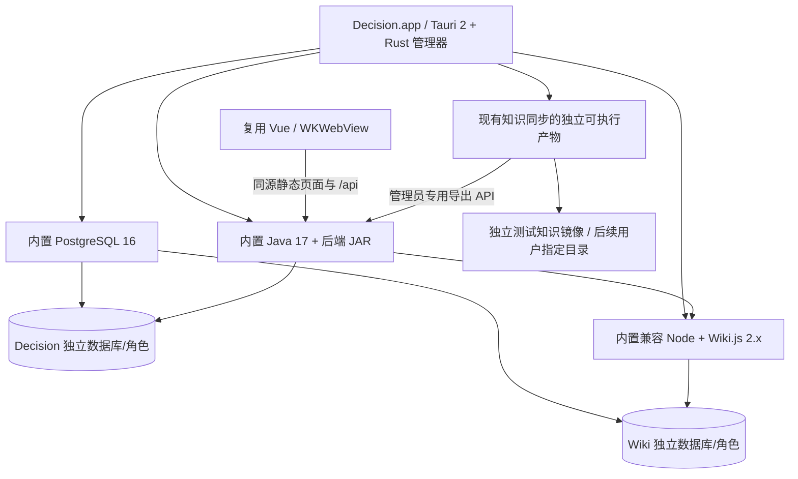

# Decision.app 桌面化实施方案

日期：2026-11-09（北京时间）

状态：用户于 2026-11-11 授权按本方案实施阶段 1–4，阶段 5 正式数据切换另行确认。运行时兼容性与交付验收以 PROGRESS.md 的实际记录为准。
## 1. 已核实的基线

- 项目：项目根目录；分支 `integration/mvp-20261104`；HEAD `da7fcdf9a9008978f399f0d4bffedd1922305543`。
- 已阅读项目 `AGENTS.md`、`PROJECT_STATE.md`、MVP 计划/契约/总控任务卡、`docs/desktop-feasibility.md`，并检查前后端配置、API 过滤器、Worker、附件解析、Wiki 接口、Compose、知识同步及测试入口。
- 工作区有未跟踪的 `docs/desktop-feasibility.md`，保护其内容，不把它当作当前提交的一部分。旧报告的 Docker 过渡壳建议由本次明确的无 Docker 目标替代。
- Vue 3/TypeScript/Vite 使用相对 `/api/v1`；Java 17/Spring Boot 3.5.16 使用 JDBC/Flyway/PostgreSQL。Wiki 接入按 2.x GraphQL 实现。知识镜像为独立 Python 脚本，目前依赖源码目录的状态和配置路径。
- 后端依赖 PostgreSQL 语义；换 SQLite 会扩大改动。`Worker.recover()` 即使关闭 worker 调度仍会在启动时修改 running 任务；Flyway 默认启动执行。新后端不得连接现有业务库。
- 当前健康接口仅返回固定状态。附件解析会派生 `java.home/bin/java` 子进程。`ApiFilter` 当前作用于全部请求，不能直接增加静态页面而不调整过滤范围。
- 本机为 Apple Silicon，macOS 27.2；已发现 Java 17 arm64、Node 24、Maven、Apple SDK/签名工具。常规 PATH 及已检查的默认路径未发现 Rust 工具链和 PostgreSQL 服务端；不据此断言整机未安装。开发工具准备与交付包内置运行时分别处理。
- 本次没有启动/停止服务，没有访问业务记录、读取真实配置密钥、操作数据库或 Docker 卷，也没有安装运行时。历史文档中的容器健康不作为本轮实时证据。

## 2. 推荐确认的架构

直接建设无 Docker 的原生应用，保留现有业务栈。Tauri 负责窗口与服务生命周期，Java 继续负责业务。

### A. 一套原生 PostgreSQL，两个独立数据库和运行角色

保留业务库和 Wiki 库的逻辑边界、表结构及业务权限；每个服务仅使用自己的非超级用户角色，并限制跨库连接。数据库管理员凭据单独管理。相比两个集群，减少一套进程、端口和生命周期配置；代价是两库共用服务重启和版本升级。若隔离原型发现真实兼容性或恢复限制，再讨论保留双集群，不在开发中悄悄改换架构。

### B. Java 同时提供打包后的 Vue 静态资源和现有 `/api`

Tauri 业务窗口加载应用自有的 loopback 服务，用户无需输入网址。Vue 的相对 API 路径和业务逻辑大部分保留，不再需要 Nginx。新增桌面配置和静态资源路径，精确限定 API 过滤器的范围，保持 API 鉴权。网页部署继续使用原来的构建及部署方式。

为每个桌面环境持久化本地站点端口，保护 WebKit 的 origin 与 IndexedDB/草稿关联；端口占用时报告冲突，不静默换站点、清理缓存或杀占用者。Wiki 地址也保持稳定，避免已有 Wiki 链接随启动改变。具体端口与身份挑战方案在实现中验证。

业务页面不获得通用 shell/文件系统权限；原生启动与诊断界面只暴露必要的受限命令。外链交系统浏览器，限制窗口导航。服务身份验证、loopback 绑定、Host/Origin 校验与接口认证一起设计，不能把本机端口当成身份凭据。

### C. 复用知识同步实现，打包成独立产物

先保留 Python 的渲染、清单、冲突保护和安全写入行为，只适配配置、状态和路径注入，通过原生 arm64 独立可执行产物随包交付。用户无需安装 Python。不再调用绑定仓库路径的 `manage.py up`。测试镜像独立于现有 Obsidian 目录，应用内仍仅管理员启用共享镜像。

### D. 应用包包含全部运行资源，数据放用户目录

- `.app` 内保存只读程序：Tauri、Java 17 运行时、JAR、Vue 产物、PostgreSQL 二进制和所需动态库、Node、Wiki.js 及依赖、知识同步可执行文件、许可证清单。
- 可变数据保存到 `~/Library/Application Support/<应用标识>/`，包括数据库、Wiki 可写目录、同步状态及配置；日志使用用户日志目录，临时附件使用应用临时目录。
- 开发/测试与正式版使用不同应用标识、目录、端口及 Keychain 命名空间。私密凭据存 Keychain，按需安全注入；不进入命令行、前端、安装包或日志。测试不读取生产 `.env`。
- 固定组件版本、来源与校验和；逐个检查 arm64、动态库加载路径和嵌套签名。构建可使用开发工具，交付包不能依赖 Homebrew 路径或当前机器的运行时。

## 3. 生命周期与恢复行为

1. 启动先拿单实例锁，核验数据目录、安装身份、配置与端口。已有目录缺失关键文件或疑似损坏时停止并报告，不自动当作首次运行重新建空库。
2. 启动 PostgreSQL → 认证查询确认两库可用 → Java 与 Wiki → 验证 Java 迁移/数据库 readiness 和 Wiki 就绪 → 启动同步并展示业务窗口。Wiki 初始化、管理员配置和 API token 的创建也属于原型验证范围，不能以页面返回 200 代替可写可读。
3. 核心、Wiki、同步分别报告状态；Wiki/同步异常允许核心可用并明确提示。readiness 不写业务、不调用收费模型；模型仅显示配置/网络限制，真实调用单独验收。
4. 管理自有子进程及解析子进程，使用 PID、启动身份和锁等证据确认归属，不使用按进程名或端口批量杀进程。普通服务崩溃有限退避重启；数据库损坏、迁移失败、配置错误不无限重试。
5. 自动恢复服务不自动重放中断的模型任务；保持现有明确重试语义。保留脱敏错误与重试入口，验证休眠唤醒和网络恢复。
6. 推荐关闭窗口保留 App 和自有服务，点 Dock 重开；Cmd-Q 真正退出时先停止接收新工作，再停止同步/Java/Wiki，最后正常关闭 PostgreSQL。异常退出后校验并接管或清理可证明属于本 App 的遗留进程；强退及子进程残留列入测试。
7. 不设置登录项，不自动启动观察、录屏、Pensieve 或额外通知；不管理现有 Docker 服务。

## 4. 分阶段实施与验收

| 阶段 | 实施内容 | 通过标准 |
| --- | --- | --- |
| 0：调查（已完成） | 读文档/源码、独立审查、形成方案 | 已识别目标差异、复用点、数据风险、关键选择；等待确认 |
| 1：原生隔离运行原型 | 准备受控构建工具与可重定位 arm64 运行时；全新 PG 目录/两库/密钥；运行 Java、Wiki 和同步 | 合成账号登录/隔离、附件子 Java 解析、Wiki 初始化及真实写读、合成知识导出镜像通过；复制到另一目录仍能启动，不使用 Docker、生产配置/库/镜像目录 |
| 2：Tauri 管理器 | 启动/故障界面、单实例、进程归属、健康状态、有限恢复、退出和 Keychain 接线；Java 静态页面及同步路径最小适配 | 直接启动桌面程序完成依赖编排；端口冲突、子进程崩溃、休眠唤醒、连续启动/退出可解释且可恢复；不误停其他进程 |
| 3：业务回归 | 复用现有测试并增加原生 PG 测试入口、WKWebView 实测；保留原网页开发方式 | 对话/资料/附件/记忆/确认知识/图谱/多账号隔离/Wiki/镜像/持久化通过；草稿、IndexedDB、剪贴板、外链、下载和故障恢复有实测证据；模型替身与真实模型结果分列 |
| 4：独立应用包 | 打包 Decision.app，校验 runtime/动态库/许可证/嵌套签名；安装位置和路径含空格验证 | 移出源码目录，终端未启动任何服务、Docker 不参与、精简 PATH 下可双击；在没有开发 runtime 的干净 arm64 环境验证启动/写入/重开，验证卸载包不会删数据；无干净机器时明确保留该验收缺项 |
| 5：正式数据切换（另行确认） | 提交具体备份/恢复/校验/停写/切换/回退步骤，获准后实施 | 现有记录/账号/附件哈希、Wiki 两库与两处卷文件、密钥及链接核验；独立恢复演练通过；切换后新写入的回退保护明确；原卷保留到用户验收 |

阶段 1 是实施风险验证，不提前承诺运行时组合已经兼容。若组件不兼容，优先调整打包与兼容版本；替换 Wiki、改变数据库类型、删除业务能力需再次讨论。

## 5. 数据与协作边界

- 阶段 1–4 使用新建隔离数据。不会连接现有业务数据库、读取/迁移私人备份、改动原 Docker 卷或现有知识镜像，也不停止现有服务来验证应用。
- 生产迁移不是复制 Docker 数据目录：使用两库逻辑导出/恢复，并核对 Wiki 父卷和嵌套 content 匿名卷；保留身份密钥、账号归属及引用。浏览器未发送草稿/附件另有存储边界，不声称随数据库自动迁移。
- 跨服务一致性备份需安排停写或明确一致性措施。正式切换后产生的新数据必须纳入回退，不能简单重新打开旧库。
- 第一批可运行桌面包会清楚标记隔离测试环境；它不等于已迁入本人旧数据的正式应用。
- 开工核对既有 worktree、角色归属和修改权，桌面工程使用独立功能分支/worktree；必要 backend/web 改动遵守 A/B 目录归属与总控契约，不直接在共享目录切分支、覆盖同伴或未提交改动。不自动合并 main。
- 确认后在项目维护桌面架构/阶段进度/测试矩阵与开发启动说明，每阶段记录实际通过、失败和未测项。现有网页、后端及同步测试优先复用；当前 `backend/test.sh` 依赖 Docker，需提供显式指向原生临时库的测试入口。
- 当前只交付调查和方案；未进行构建、测试或数据迁移。

## 6. 发布范围

首要目标是本机 Apple Silicon 可实际使用的完整 `.app`。可先交本机构建并验证的签名应用；给其他 Mac 下载的正常分发另需 Developer ID、公证及干净机器验证。没有证书或验证环境时如实列出缺项，不把本机能启动描述为任意 Mac 无提示安装。此事不阻止先开发与验收本机应用，也不要求提前购买账号。

## 7. 依据

- Tauri 2 支持随包外部可执行文件，但需要对应目标架构，不能自动解决运行时与动态库打包：[Embedding External Binaries](https://v2.tauri.app/develop/sidecar/)。
- Java 同源静态资源方案可利用 Spring Boot 现有静态资源服务，再增加桌面配置与安全适配：[Spring Boot 3.5 Servlet Web Applications](https://docs.spring.io/spring-boot/3.5/reference/web/servlet.html)。
- 保持 Wiki.js 2.x API 契约，先验证兼容 Node 及原生依赖，不顺带升级大版本：[Wiki.js 2 文档](https://docs.requarks.io/)。
- 跨平台数据库迁移使用逻辑导出恢复；两个数据库的独立 dump 不自动形成跨服务同一时点快照：[PostgreSQL 16 SQL Dump](https://www.postgresql.org/docs/16/backup-dump.html)。
- 本机 ad-hoc 签名与面向其他用户的 Developer ID/公证分发需区分：[Tauri macOS Code Signing](https://v2.tauri.app/distribute/sign/macos/)。

已确认采用上述原生服务栈、单 PG 集群双库、Java 同源前端、保留同步实现的独立打包，以及“关窗保留、Cmd-Q 退出”行为。生产迁移待阶段 5 的具体方案单独批准。
